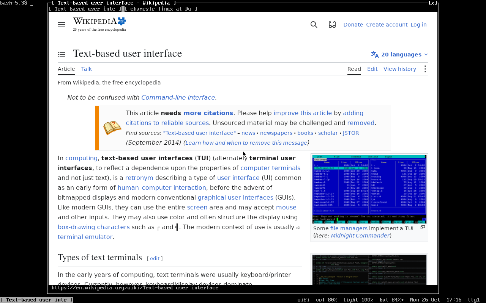

interber, a web browser that looks like a tty
=============================================

The whole window is the page. There's one line at the bottom to type in,
the console's font and colours, and the tabs go on top when there's more
than one:

	[ github ] [ youtube ]
	...the page...
	https://github.com/tortr-rs/interber                      42%

Type an address, or just words to search. The home page is your bookmarks.

It's one C file on WebKitGTK, the same engine surf and GNOME Web use, so
pages work like they do in those. Made for [ttywm](https://github.com/tortr-rs/ttywm)
but it runs anywhere with X11 or Wayland.

Needs gtk3 and webkit2gtk-4.1.

Install
-------
	make
	sudo make install

or on Chamesle Linux:

	sudo apk add interber

Settings
--------
Everything is in ~/.config/interber/config, made the first time it starts.
Plain words:

	home page = interber:home
	search = https://duckduckgo.com/?q=%s
	remember tabs = on
	javascript = on
	zoom = 100%
	downloads = ~/Downloads
	text colour = grey
	background colour = black

Change a line and save, it works from the next page you open.
Bookmarks are in ~/.config/interber/bookmarks, one "address name" a line,
so you can edit them by hand too.

Keys
----
	Ctrl+l              type an address or a search
	Ctrl+t              new tab
	Ctrl+w              close tab
	Ctrl+Shift+t        bring back the tab you closed
	Ctrl+Tab            next tab, Ctrl+1..9 go to a tab
	Alt+Left/Right      back, forward
	Ctrl+r              reload
	Ctrl+f              find on the page, Enter for the next one
	Ctrl+d              bookmark the page
	Ctrl+plus/minus/0   zoom
	F11                 full screen
	Ctrl+h              home
	Ctrl+q              quit

Middle click or Ctrl+click a link to open it in a new tab, middle click a
tab to close it. The mouse's side buttons go back and forward. Downloads
go straight into ~/Downloads.

The font is the IBM VGA one from the console.
